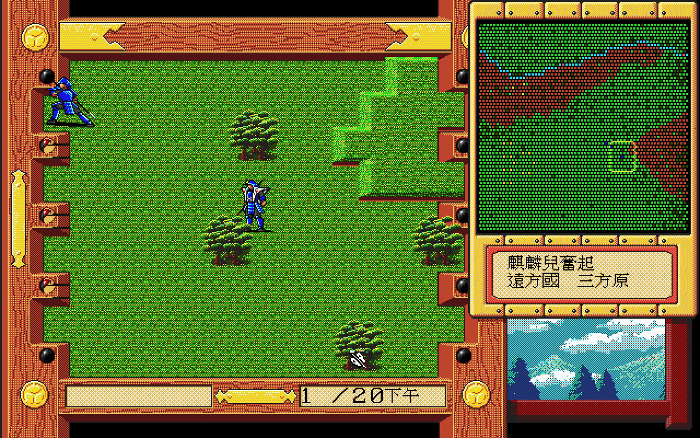
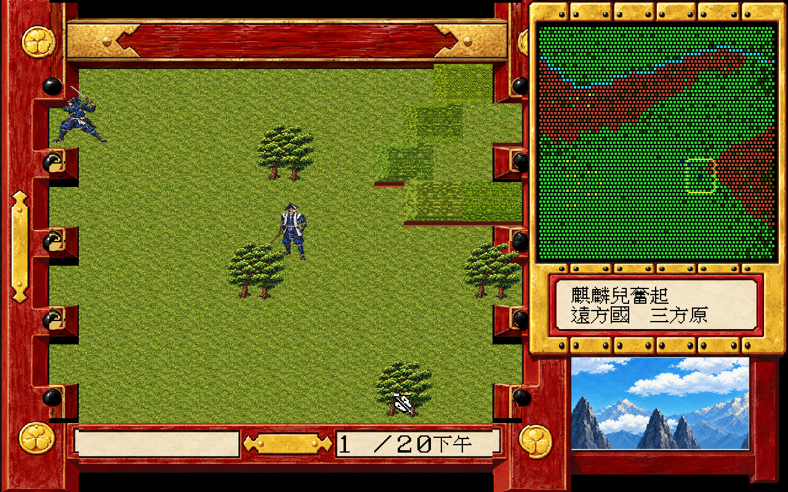

# 德川家康 × dosgolem

讓 DOS 原版《德川家康》在現代桌面執行，沿用原版程式、玩法與資料，加入戰國手繪 HD、CD 音樂播放及可隨時切換的顯示介面。

正式版：[1.0.0（v.1.0.0-20261017）](https://github.com/wicanr2/tokugawa-dosgolem/releases/tag/v.1.0.0-20261017)。

## 遊戲沿革

《德川家康》的日文名稱為《乱世英傑シリーズ第二弾 徳川家康》。依 [MAME 的 PC-98 軟體目錄](https://github.com/mamedev/mame/blob/eb947cba9b909d29d4f9fb2851e2ee69789d0be0/hash/pc98.xml#L40741)，日本版由 Family Soft 發行，記錄的發售日期為 1992 年 12 月 10 日，媒體為五張磁片。作品以家康為中心，將戰國人物、劇情與分章戰場結合，呈現一段從強敵環伺走向天下爭奪的歷史旅程。

繁體中文版的年代另有紀錄。民間整理的[《遊戲總表》](https://chiuinan.github.io/game/game/list-1.htm)將《德川家康》列為 1997 年作品，公司欄標示「Family（彩虹）」，媒體為一張 CD。本專案保存的是繁中 DOS 光碟版本，具有 Rainbow Multimedia 開場標誌、中文劇情與原版 CD 音樂；其實際檔案、標誌與音軌已在[本專案來源紀錄](RESEARCH-LOG.md#遊戲沿革與歷史背景來源補充)核對。日本版與繁中版的年份分別依各自目錄記載。

這次保存工作讓原有 DOS 程式繼續負責故事、戰鬥與存檔，由 dosgolem 接到現代桌面，再加入可切換的戰國手繪 HD。人物肖像、劇情捲軸、戰場與出版商標誌換上新圖，玩家仍能隨時切回熟悉的原版畫面，在原有 CD 配樂中重訪這部作品。

## 德川家康與日本戰國

德川家康幼名竹千代，出身三河岡崎的松平家。少年時代，他曾以人質身分輾轉於織田與今川兩家。1560 年，今川義元在桶狹間之戰陣亡，家康返回岡崎，逐步重整三河勢力；1562 年，他與織田信長結盟。這段早年經歷，是理解家康為何必須在強鄰之間選擇盟友、保全領地的起點。生平與同盟年代見[岡崎市觀光協會的家康年表](https://okazaki-kanko.jp/okazaki-park/feature/history/about)。

1570 年，家康將居城移到濱松，勢力向遠江伸展，也與武田家的擴張正面相遇。元龜三年冬的三方原之戰，他出城迎擊武田信玄，遭到重創，多名家臣戰死。三年後的長篠之戰，織田、德川聯軍擊敗武田勝賴，局勢出現轉折。三方原的敗戰與長篠的勝利，也構成遊戲前段故事的歷史背景。參考[濱松市家康年表](https://www.city.hamamatsu.shizuoka.jp/ieyasu/study/chronology.html)、日本國立公文書館的[三方原之戰](https://www.archives.go.jp/exhibition/digital/ieyasu/contents1_05/)與[長篠之戰](https://www.archives.go.jp/exhibition/digital/ieyasu/contents1_06/)介紹。

1582 年本能寺之變後，信長留下的權力格局重新洗牌。家康與羽柴秀吉在 1584 年的小牧、長久手之戰交鋒，之後於 1586 年向秀吉臣服。1590 年，他被轉封關東，進入江戶。此時的家康已從三河地方大名，成為豐臣政權下擁有廣大領地的重要勢力。相關脈絡見日本國立公文書館的[小牧、長久手之戰](https://www.archives.go.jp/exhibition/digital/ieyasu/contents2_01/)介紹及[家康生涯年表](https://www.archives.go.jp/exhibition/digital/ieyasu/history.html)。

1598 年秀吉去世，幼年的秀賴繼承豐臣家，政權內部的權力平衡逐漸瓦解。家康與石田三成等人的對立，最終走向 1600 年的關原之戰。家康方獲勝後，於 1603 年受任征夷大將軍，在江戶開設幕府，建立新的武家統治中心。這是他從豐臣政權重臣走向天下人的關鍵轉折。參考[日本國立公文書館的關原之戰介紹](https://www.archives.go.jp/exhibition/digital/ieyasu/contents3_01/)。

幕府成立後，德川與豐臣之間的緊張仍未解除。1614 年大阪冬之陣，真田幸村率軍在真田丸抵抗德川軍；翌年的大阪夏之陣，豐臣方敗亡。家康於 1616 年去世，留下由德川家延續的江戶幕府。他的一生跨過地方大名爭戰、天下統一與幕府建立，也讓遊戲最後的戰場承接了整個時代的轉變。參考日本國立公文書館的[大阪冬之陣、夏之陣](https://www.archives.go.jp/exhibition/digital/ieyasu/contents5_04/)介紹與[生涯年表](https://www.archives.go.jp/exhibition/digital/ieyasu/history.html)。

## 遊戲故事背景

元龜三年冬，武田信玄的大軍進逼遠江，德川軍面臨三方原的危局。歷史上的家康將來會成為幕府開創者，遊戲中的他此刻卻必須先活過眼前的戰事。第一章「麒麟兒奮起」由此展開，將玩家帶進軍議、人物對話與出陣抉擇，再走上部隊對峙的戰場。

隨著章節年代推進，故事從武田軍的威脅，轉向家康與秀吉的角力，再來到關原的天下之爭。後段的真田六連錢與大阪之陣，則把德川軍帶到另一場決定時代走向的戰事。玩家從德川軍的視角調度武將與部隊，在各章設定的期限與目標中尋找出路；保全家康、應對強敵與爭取勝機，貫穿這段征途。

原版十二章的主要時代與篇章如下，章名與年號依[原版章節文字證據](RESEARCH-LOG.md#故事背景來源)整理。

| 原版章節 | 故事年代 | 歷史背景 |
|---|---|---|
| 第 1 章「麒麟兒奮起」 | 元龜三年，1572 年 | 三方原危局，德川軍面對武田信玄 |
| 第 2 章「風林火山的落日」 | 天正三年，1575 年 | 長篠之戰時期，織田、德川與武田的對抗 |
| 第 3～6 章，「逆風的三葉葵」至「黃金的天下人」 | 天正十二年，1584 年 | 信長身後的權力爭奪，家康與秀吉的交鋒 |
| 第 7～9 章，「決戰之序曲」至「命運的關原」 | 慶長五年，1600 年 | 關原前夕與東西兩軍的決戰 |
| 第 10～12 章，「疾風！真田六連錢」至「成為堅如盤石的日本」 | 慶長十九年至元和元年，1614～1615 年 | 大阪冬之陣、夏之陣與德川、豐臣的最後對決 |

史實提供理解故事的脈絡；劇情對白、戰場期限、選項與勝敗條件仍以遊戲自身設定為準。現在可以在保留原版文字與 CD 音樂的畫面中，切換手繪人物、捲軸與戰場，重新走進這段從三方原到大阪的故事。

## 遊戲畫面

第一章三方原戰場，同一遊戲狀態切換原版與戰國手繪 HD。文字與小地圖保留原版。點圖可看完整尺寸。

| 原版 | 戰國手繪 HD |
|---|---|
|  |  |

截圖來自 Linux 桌面 v.0.1.0 的正常首戰，裁去視窗底部的非遊戲區域。1.0.0 沿用相同的遊戲呈現與 HD 素材。原版畫面中的美術與文字權利歸原權利人，截圖僅作本專案介紹。

## 桌面版內容

- 啟動時選擇原版或 HD，出版商 MARK 標誌也支援 HD，最後設定沿用到遊戲。
- 戰國手繪 HD 涵蓋已盤點的人物、場景、戰場、捲軸與介面；缺圖或未知顯示狀態回原版。
- 播放原版光碟音樂，存檔寫入獨立使用者目錄，保留原版資料。
- 滑鼠移到視窗頂端可展開功能列，隨時切換原版／HD、暫停與截圖。

遊戲操作以滑鼠為主。啟動選擇也可使用 Tab／Enter。

| 操作 | 功能 |
|---|---|
| 滑鼠移到頂端、Esc | 展開或收起功能列 |
| F6 | 切換原版／HD |
| F7 | 暫停／繼續 |
| F9 | 截圖 |

目前原版入口、選單、劇情、首戰、代表性交鋒及存讀檔已有抽樣驗證；HD 另有來源、繪圖、切換與缺圖驗證。CD 桌面輸出已做技術擷取，人耳及實體桌面的預設速度效能尚未確認。四語切換尚未實作。完整範圍與限制以 [CONTEXT.md](CONTEXT.md) 為準，正常通關不列本次驗收門檻。

## 三平台完整版

目前正式版本為 `v.1.0.0-20261017`。解壓後啟動 Windows／Linux 執行檔，或開啟 macOS 的 `Tokugawa.app`；詳細操作與存檔位置見包內 README.txt。

| 平台 | 架構 | 完整版 | 已驗證範圍 |
|---|---|---|---|
| Windows | amd64 | [ZIP](dist-all/v.1.0.0-20261017/full-local/tokugawa-dosgolem-v.1.0.0-20261017-windows-amd64.zip) | Wine 啟動、MARK、正常標題、功能列切換與關窗 |
| Linux | amd64 | [ZIP](dist-all/v.1.0.0-20261017/full-local/tokugawa-dosgolem-v.1.0.0-20261017-linux-amd64.zip) | X11 啟動、MARK、正常標題、功能列切換與關窗 |
| macOS | Intel | [ZIP](dist-all/v.1.0.0-20261017/full-local/tokugawa-dosgolem-v.1.0.0-20261017-macos-amd64.zip) | 編譯與格式核對，待真機試跑 |
| macOS | Apple Silicon | [ZIP](dist-all/v.1.0.0-20261017/full-local/tokugawa-dosgolem-v.1.0.0-20261017-macos-arm64.zip) | 編譯與格式核對，待真機試跑 |

[封包 SHA-256](dist-all/v.1.0.0-20261017/SHA256SUMS.json)與[驗證收據](dist-all/v.1.0.0-20261017/smoke/verification-summary.json)保存在同一版本目錄。完整版含原版遊戲與解碼參考，只留本機，不加入 Git 或 GitHub Release。公開 Release 提供版本說明與原始碼入口。

## 推廣影片

[觀看 72 秒、1080p 推廣影片](dist-all/v.0.1.0-20261016/promo/tokugawa-dosgolem-v.0.1.0-20261016-promo.mp4)。畫面錄自正式 Linux 封包的正常啟動、劇情與首戰，經剪輯與速度調整，展示原版／HD 與頂端功能列切換；配樂取自原版 CD。影片與素材只留本機，來源及檢查收據保存在同一 promo 目錄。

## 文件與素材

- [工作規則、建置與驗證入口](AGENTS.md)
- [目前狀態](CONTEXT.md)
- [後續工作與四語規劃](WORKLIST.md)
- [逆向與來源證據](RESEARCH-LOG.md)
- [HD 圖像與完整提示詞](assets/hd-b/README.md)
- [工作歷程](WORKLOG.md)

程式、文件與生成素材公開於儲存庫 [wicanr2/tokugawa-dosgolem](https://github.com/wicanr2/tokugawa-dosgolem)，適用條款見下方授權。原始下載只存本機 original/，研究與錄製素材存 workplace/，交付存 dist-all/；三者均排除版控。完整版與影片連結指向本機檔案，GitHub 不提供含原版資料的下載。開發與研究使用 dosgolem 固定副本，桌面封包可獨立執行。

## 授權

自製程式與文件採 source-available [RRSAL-1.0](LICENSE)。非商業使用免費，商業用途另洽；原版資料、美術與音樂不在授權範圍，第三方元件沿用各自條款。本專案與原版權利人沒有隸屬或官方授權關係。
